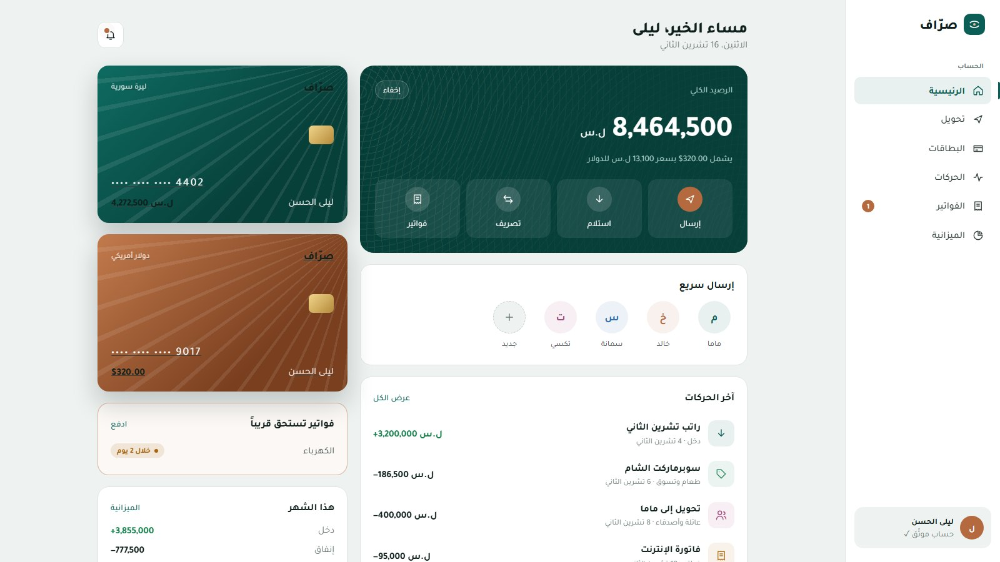

<div align="center">

# صرّاف · Sarraf

**Multi-currency digital wallet: transfers, bills and a monthly budget**

[](https://abdulhadi.review/#demo/sarraf) [](https://abdulhadi.review)

`React` · `TypeScript` · `Vite` · `CSS Modules` · `Figma`



</div>

---

<div dir="rtl" align="right">

## عن المشروع

**محفظة رقمية** · 2025

تطبيق محفظة رقمية يركّز على ثلاث مهام يومية: معرفة الرصيد، إرسال المال، ودفع الفواتير، مع تحليل شهري يوضح أين يذهب الإنفاق.

**المشكلة:** تطبيقات الدفع الشائعة تزدحم بالخدمات فيضيع الأهم: كم معي الآن، وكم أنفقت هذا الشهر، وكيف أحوّل بسرعة لمن أتعامل معهم دائماً.

**الحل:** شاشة رئيسية بثلاثة أزرار فقط، قائمة مستفيدين متكررين بلمسة واحدة، وتصنيف تلقائي للحركات يُبنى عليه تحليل الميزانية.

### أبرز المزايا

- رصيد لحظي وبطاقة افتراضية لكل عملة
- تحويل إلى المستفيدين المتكررين برمز QR أو رقم الهاتف
- دفع الفواتير الدورية مع تذكير قبل الاستحقاق
- ميزانية شهرية وتصنيف تلقائي للإنفاق
- قفل بالبصمة وتأكيد ثنائي للتحويلات الكبيرة

</div>

---

## Run locally

```bash
npm install
npm run dev        # http://localhost:5173
npm run build      # type-check and build to dist/
```

An interactive prototype from my portfolio. Demo data is generated in the browser and saved to localStorage only.


---

Designed and built by **Abdulhadi Almohammad** ([@abood352](https://github.com/abood352)) · [abdulhadi.review](https://abdulhadi.review)
